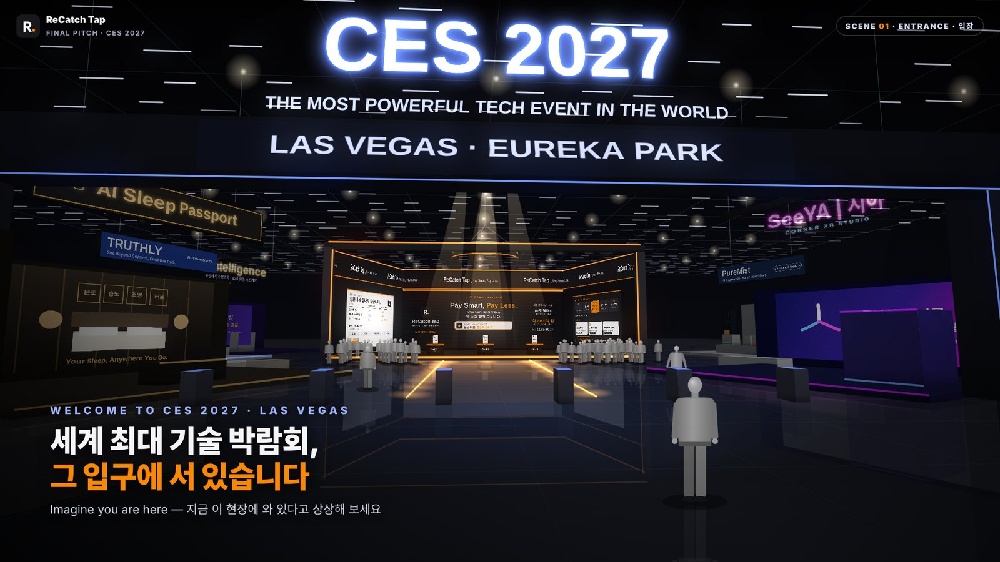

<div align="center">

# ReCatch Tap · CES 2027 Virtual Booth Pitch

### 생성형 AI 활용 해외마케팅 (CES 2027 연계) — 최종 발표

**Pay Smart, Pay Less.**

<br>

<a href="https://seungbeenyoo.github.io/ReCatchTap-CES2027/">
  
</a>
<p>▲ <b>이미지를 클릭하면 <u>[CES 2027 가상 부스 발표]</u>가 열립니다.</b></p>

<p>
  <a href="https://seungbeenyoo.github.io/Recatch-APP/"><b>📱 연결된 앱 프로토타입 바로가기 →</b></a>
</p>

</div>

> **안내** — 이 저장소의 **ReCatch Tap(리캐치 탭)** 은 교육 프로그램 「생성형 AI 활용 해외마케팅 (CES 2027 연계)」에서 팀 과제로 기획한 **가상의 아이템**입니다.
> CES 2027 참가, 부스, 관람객, 시장 수치 화면 등은 모두 발표를 위한 **가상 시나리오**이며, 실제 출시 제품이나 실제 전시가 아닙니다.
> 화면 속 다른 팀 부스(AI Sleep Passport · PureMist · SeeYA · TRUTHLY · Skintelligence)는 같은 프로그램에 참여한 팀들의 컨셉을 배경으로 표현한 것입니다.

---

## 📌 프로젝트 소개

**ReCatch Tap**은 계산대 NFC 칩에 폰을 대면, 내 카드·멤버십 중 **가장 큰 할인과 바코드를 한 번에** 띄워 주는 가상의 NFC 결제 비서입니다.

| 항목 | 내용 |
|---|---|
| 프로그램 | 생성형 AI 활용 해외마케팅 (CES 2027 연계) |
| 아이템 | ReCatch Tap (가상) · 핀테크 / 리테일 테크 |
| 해결할 문제 | 혜택은 많은데, 계산대 앞에서는 뭘 써야 할지 모릅니다 |
| 작동 방식 | 계산대 NFC 칩에 폰을 대면, 할인이 뜹니다 |
| 슬로건 | Pay Smart, Pay Less. |
| 팀 | 유승빈 · 박지윤 · 이창민 · 백종민 |

이 저장소는 최종 발표에서 사용하는 **3D 가상 CES 부스 시뮬레이션**입니다.
발표자는 포인터로 장면을 하나씩 넘기고, 청중은 QR 코드를 찍어 각자 폰에서 앱 프로토타입을 직접 체험합니다.

---

## 🎬 발표 장면 구성 (6장면)

| # | 장면 | 내용 |
|---|---|---|
| 1 | ENTRANCE · 입장 | CES 2027 전시장 입구, 정면에 스포트라이트를 받는 ReCatch 부스 |
| 2 | WALK IN · 1인칭 | 1인칭 시점으로 주변을 둘러보며 부스 앞까지 이동 |
| 3 | DETAIL · 부스 둘러보기 | 왼쪽 벽(차별화 UVP) → 오른쪽 벽(기술 아키텍처 · 독점 우위) 확대 |
| 4 | TAP · 폰을 대면 | 포디움 NFC에 폰을 대면 결제 감지 → 할인 알림 → 재결제 바코드 (앱 화면 시연) |
| 5 | LIVE DEMO · 직접 체험 | QR 코드로 청중이 직접 앱 체험 (15초 타이머) |
| 6 | FINALE · 마무리 | 줌아웃 · 조명 · 불꽃과 폭죽 · 슬로건 · 팀 소개 |

---

## 🎮 발표 조작법

| 버튼 | 동작 |
|---|---|
| 포인터 다음 · `PageDown` · `→` · `Space` | 다음 장면 |
| 포인터 이전 · `PageUp` · `←` | 이전 장면 |
| `R` | 현재 장면 처음부터 다시 |
| `F` | 전체화면 켜기 / 끄기 |
| `1` ~ `6` | 해당 장면으로 바로 이동 |
| `Home` · 마지막 장면의 **다시 시작** 버튼 | 시작 화면으로 돌아가기 |

- 다음 장면을 미리 불러와 대기하므로, 포인터를 누르는 즉시 넘어갑니다.
- 외부 라이브러리 없이 HTML 파일만으로 동작합니다. 첫 접속 후에는 현장 와이파이가 불안정해도 진행할 수 있습니다.
- 파일을 더블클릭으로 열면 브라우저 보안 때문에 포인터 키가 동작하지 않을 수 있습니다. **반드시 GitHub Pages 주소로 열어 주세요.**

---

## 📁 파일 구조

```
├── index.html     # 시작 페이지 + 장면 전환(포인터 제어)
├── scene1.html    # 1 입장
├── scene2.html    # 2 1인칭 이동
├── scene2b.html   # 3 부스 양옆 벽 확대
├── scene3.html    # 4 폰을 대면 (앱 시연)
├── scene4.html    # 5 QR 청중 체험
├── scene5.html    # 6 마무리
├── images/
│   └── preview.jpg  # README 미리보기 이미지
└── README.md
```

---

## 🚀 GitHub Pages 배포

1. 이 저장소를 **Public** 으로 만듭니다.
2. **Settings → Pages → Build and deployment**
   - Source: `Deploy from a branch`
   - Branch: `main` / `(root)` → **Save**
3. 1~2분 뒤 `https://<GitHub 아이디>.github.io/<저장소 이름>/` 으로 접속합니다.
4. 시작 화면에서 **발표 시작 ▶** 을 누르면 전체화면으로 시작됩니다.

---

## 📱 연결된 앱 프로토타입

- ReCatch 앱 프로토타입: <https://seungbeenyoo.github.io/Recatch-APP/>
- 5번 장면의 QR 코드는 위 프로토타입(로그인 없는 체험 버전)으로 연결됩니다. 홈 화면에서 **재결제 체험**을 누르면 됩니다.

---

<div align="center">

**ReCatch Tap** · 생성형 AI 활용 해외마케팅 (CES 2027 연계)

유승빈 · 박지윤 · 이창민 · 백종민

<sub>본 저장소의 아이템, 부스, 수치, 시나리오는 교육용 가상 기획이며 실제 제품·전시·기업과 무관합니다.</sub>

</div>
